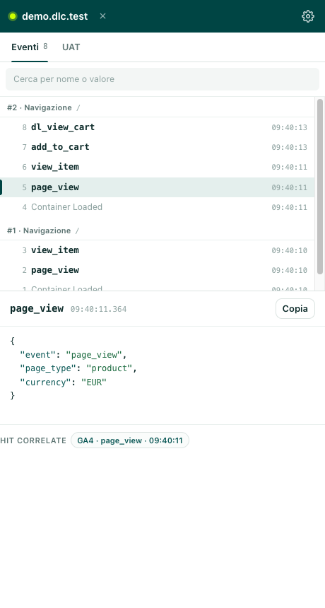
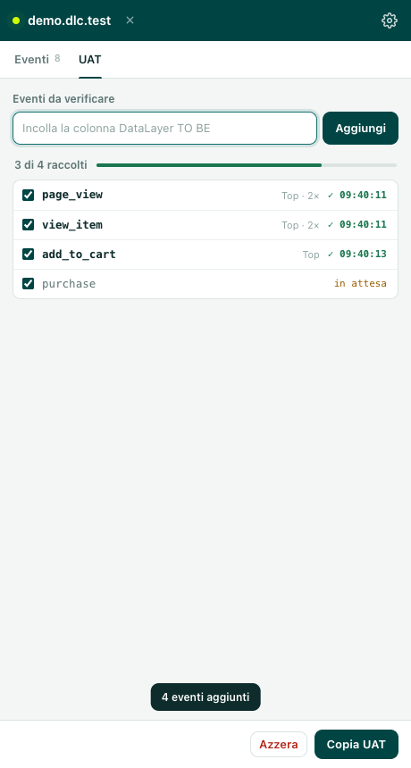
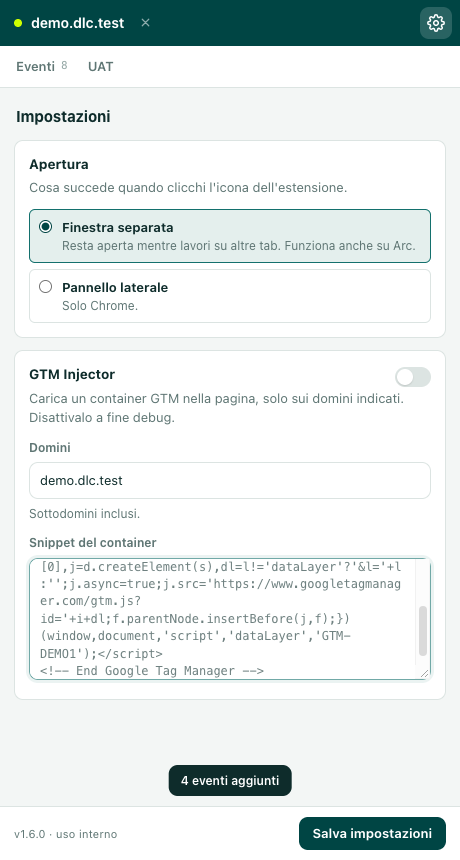
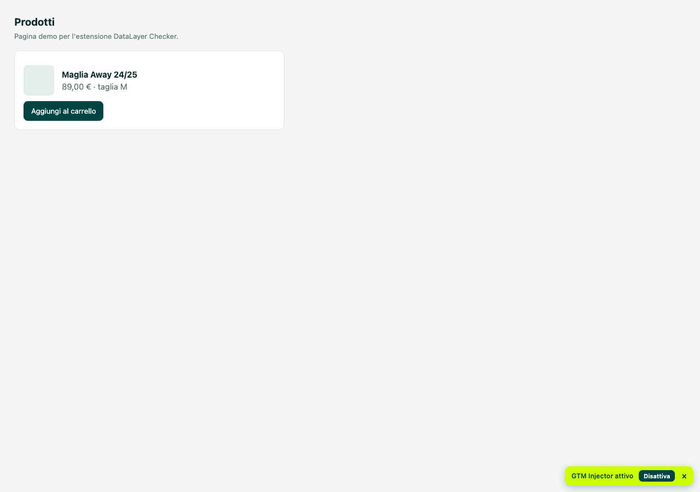

# DataLayer Checker Revamp

Estensione Chrome (Manifest V3) per ispezionare il `dataLayer`, vedere le hit dei vendor e
iniettare un container GTM su un dominio specifico. Si apre in una **finestra separata** (o nel
side panel, se preferisci): si lavora di fianco alla pagina, senza aprire la console.

Uso interno del team. Non è pubblicata sullo store e non va ridistribuita fuori dal team.

## Installazione (5 minuti, una volta sola)

Serve Chrome 116 o superiore e accesso alla repo privata: se `git clone` ti risponde
"repository not found", chiedi di essere aggiunto come collaboratore.

```bash
git clone https://github.com/patternlover/datalayer-checker-revamp.git
```

1. Apri `chrome://extensions` (o `edge://extensions`).
2. Attiva **Modalità sviluppatore** in alto a destra.
3. **Carica estensione non pacchettizzata** e scegli la cartella appena clonata (quella con
   dentro `manifest.json`, non una sottocartella).
4. Clicca l'icona dell'estensione nella toolbar: si apre la finestra del pannello.

Non serve nessun build: i file sono già eseguibili. Per aggiornarla, `git pull` e poi
**Aggiorna** (⟳) sulla scheda dell'estensione in `chrome://extensions`.

Dopo l'installazione Chrome chiede di leggere i dati di tutti i siti: è il permesso necessario
per leggere il `dataLayer` di qualunque sito tu stia testando, non un accesso in più. Dettaglio
in [Permessi](#permessi).

## Primo giro (un minuto)

Il modello è uno solo, e vale la pena leggerlo: **l'estensione lavora su una tab scelta da te,
non sulla tab che ha il focus**. Si chiama "tab in test".

1. Apri il sito da testare in una tab normale.
2. Apri il pannello e premi **Testa example.com**.
3. Naviga il sito: ogni push nel `dataLayer` compare nel pannello in tempo reale.
4. Puoi passare a Google Sheets o a un'altra tab senza perdere niente: la cattura resta sulla
   tab in test. Per spostarla, premi **Passa a …** quando la tab attiva è un altro sito.
5. Chiudi la tab e riapri lo stesso sito: lo storico viene riagganciato da solo.

Il pulsante **✕** accanto al dominio smette di testare e mette in pausa la cattura; i dati
restano finché non apri un altro sito.

## Provarla subito (senza un sito cliente)

In `docs/demo/` c'è un finto negozio con un `dataLayer` vero: eventi al caricamento, eventi al
click, hit finte verso GA4 e Meta, più due pulsanti per i casi che rompono i dataLayer veri
(svuotamento dell'array e navigazione SPA). Dalla cartella `docs/demo`:

```bash
python3 -m http.server 8080
```

Apri `http://localhost:8080`, apri il pannello, premi **Testa localhost**. Su Windows senza
Python: `npx serve . -l 8080`. È anche il modo per rifare gli screenshot qui sotto; la pagina
spiega passo per passo cosa deve comparire.

## Le tre schede

**Eventi** — la lista dei push, con ricerca per nome o valore, dettaglio JSON dell'evento
selezionato e il pulsante **Copia** che copia l'oggetto nel formato incollabile in Google
Sheets. Sotto il dettaglio, quando c'è, la riga **Hit correlate**: le richieste ai vendor che
sembrano partite da quell'evento (stesso frame, entro 1,5 s, nome dell'evento uguale quando
combacia). È una correlazione probabile, non una certezza: il click su una chip copia l'URL
della hit, così si controlla.

**UAT** — la verifica di una specifica, in tre passaggi: incolla la colonna *DataLayer TO BE*
del foglio (i nomi evento vengono estratti da soli), premi **Aggiungi**, e il pannello segna
quali eventi sono già scattati. **Copia UAT** produce il blocco da incollare nel foglio. La
lista è per sito: sopravvive a refresh, chiusura della tab e riavvio del browser, e i `*` sono
ammessi come jolly (`add_to_cart*`).

**Impostazioni** — apertura (finestra separata o pannello laterale) e GTM Injector.

## Eventi Top e Pixel

Shopify scrive gli eventi e-commerce nei **Custom Pixel**, che girano in un iframe sandbox:
quel `dataLayer` non è quello della pagina. L'estensione cattura sempre entrambi e mostra il
selettore **Top / Pixel** appena riconosce un Custom Pixel (scorciatoie `T` e `P`). Il selettore
cambia solo la vista: i due `dataLayer` restano disponibili in parallelo, non si perde nulla
passando da uno all'altro.

## Hit dei vendor

`webRequest` in sola osservazione, nessuna modifica alle richieste. Vendor riconosciuti: GA4,
GTM, Google Ads, Meta, TikTok, LinkedIn, Pinterest, Hotjar, Clarity. Per ogni hit l'estensione
conosce vendor, nome evento, parametri decodificati e stato HTTP reale (una hit che parte con
204 non è una hit persa, una che finisce in errore sì): oggi questo si vede nella riga **Hit
correlate** dell'evento, non in una vista dedicata.

## GTM Injector

Carica un container GTM nella pagina, **solo sui domini che indichi** e solo nel frame
principale. Serve per provare un container prima che sia pubblicato.

1. Impostazioni → **GTM Injector** → acceso.
2. **Domini**: `example.com, staging.example.com` — i sottodomini sono inclusi, gli altri no.
3. **Snippet del container**: incolla il blocco *Google Tag Manager* completo.
4. **Salva impostazioni**.

Mentre è acceso, un banner giallo in basso a destra su ogni pagina del dominio lo ricorda.
**Disattiva** spegne l'injector; **×** chiude solo il banner per quella pagina (l'iniezione
resta attiva, e il banner torna alla navigazione dopo). Se il container è già nella pagina
l'iniezione viene saltata (eviterebbe tag e listener duplicati) e l'estensione lo dice,
invece di rompere il sito. Funziona solo su `https://`.

## Cosa non fa

- **Non verifica una specifica**: il confronto atteso/presente e l'output a quattro colonne
  sono DataLayer Doctor, un altro strumento. Qui la specifica si spunta a mano, nella scheda
  UAT.
- **Non esporta**: niente file, niente HAR. Si copia e si incolla.
- **Non funziona su `http://`**, con un'eccezione: `http://localhost` (e `127.0.0.1`), per
  provare un sito in locale senza certificati.
- **Non è multi-tab**: una sola tab in test alla volta; le altre sessioni si mettono in pausa
  e i loro dati restano.
- **Non sincronizza niente tra colleghi**: le impostazioni stanno nel tuo profilo Chrome, non
  in un account del team. Se uno snippet funziona, chi lo vuole se lo incolla.

## Cosa esce dal browser

Nessuna richiesta di rete verso server nostri o di terzi: eventi, hit e sessioni vivono in
memoria e in `chrome.storage.session`, che il browser svuota alla chiusura.

Un'eccezione dichiarata: impostazioni, elenco domini, snippet del container e preferenze
stanno in `chrome.storage.sync`, che **Chrome sincronizza con il tuo account Google**. È il
modo per ritrovare la configurazione su un altro computer dello stesso profilo. Se lo snippet
non deve uscire dal tuo disco, non usare l'injector su quel profilo.

## Screenshot

Pannello con gli eventi in streaming, il dettaglio JSON e le hit correlate:



Scheda UAT: gli eventi attesi e quali sono già scattati.



GTM Injector: domini e snippet del container.



Banner di iniezione attiva sulla pagina.



Gli screenshot si rifanno con la pagina demo in `docs/demo/` (istruzioni nel file stesso).

## Novità della 1.6.0

- Le **hit correlate** tornano visibili sotto l'evento selezionato (la vista Hit dedicata resta
tolta) e vengono ri-attribuite all'evento giusto quando arriva dopo la hit.
- Il GTM Injector **salva lo snippet quando lo accendi**: prima serviva anche "Salva impostazioni"
  e senza quel click il banner diceva "attivo" senza nessun container in pagina.
- Lo snippet incollato dal sito GTM funziona anche se contiene il blocco `<noscript>` o arriva con
  i fine riga di Windows, e un avviso dice se il codice sembra incollato male.
- Il banner ha la **×** per essere chiuso senza spegnere l'iniezione.
- Dopo un `dataLayer.length = 0` (o un `dataLayer = []`) i primi eventi del nuovo ciclo non si
  perdono più.
- Gli eventi di uno snapshot non hanno più tutti lo stesso timestamp, quindi la lista e le hit
  correlate non si confondono.
- In fondo alle impostazioni c'è la **versione** caricata: serve a capirsi quando una segnalazione
  arriva da un collega.

## Permessi

| Permesso | Perché |
| -------- | ------ |
| `host_permissions: https://*/*` | leggere il `dataLayer` e osservare le hit dei vendor su qualunque sito https tu stia testando |
| `host_permissions: http://localhost/*`, `http://127.0.0.1/*` | la pagina demo e i test in locale: senza permesso Chrome non dà all'estensione nemmeno l'URL della tab |
| `scripting` | iniettare il collector nella tab in test (e il container GTM, solo se l'injector è acceso e solo sui domini scelti) |
| `webNavigation` | agganciare il collector a ogni navigazione, cambi di pagina delle SPA compresi |
| `webRequest` | osservare le hit in uscita verso i vendor; sola lettura |
| `storage` | sessioni, impostazioni, codice dell'injector, raccolte UAT |
| `clipboardWrite` | i pulsanti "Copia" |
| `sidePanel` | la modalità pannello laterale, opzionale |

## Provenienza

Derivata da **DataLayer Checker Plus**, estensione pubblicata sul Chrome Web Store. Questo repo
è il ramo di sviluppo interno: `lib/`, `ui/` e il container probe sono lavoro nostro e il codice
si è allontanato dall'originale. La storia completa è nei commit a partire da `pre-revamp`.

## Struttura

```text
manifest.json      MV3, finestra/side panel, permessi
background.js      service worker: probe, iniezione, sessioni, webRequest
index.html         guscio del pannello
gstyle.css         stile del pannello
ui/                interfaccia: eventi, hit, uat (collect), injector, settings, store, util
lib/               logica condivisa: collect, correlation, session-store, target, vendors, flatted
scripts/           content script, banner, bridge, gtmcode, containerprobe, vendor
images/            icone
docs/              screenshot e note
```
