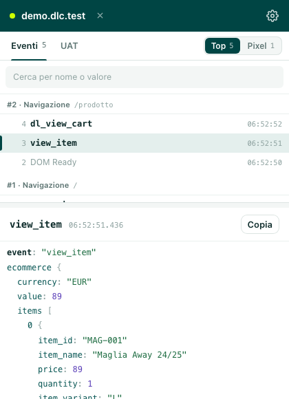

# DataLayer Checker Revamp

Estensione Chrome (MV3) per leggere il `dataLayer` di una pagina e iniettare un container GTM
su un dominio. Uso interno del team: non è sullo store e non si distribuisce fuori.



Altri screenshot in `docs/screenshots/`: pannello in finestra, scheda UAT, GTM Injector, banner di
iniezione attiva.

## Installazione (una volta sola)

Serve Chrome 116+ e accesso alla repo privata (fatti aggiungere come collaboratore).

```bash
git clone https://github.com/patternlover/datalayer-checker-revamp.git
```

1. `chrome://extensions` → **Modalità sviluppatore**.
2. **Carica estensione non pacchettizzata** → la cartella clonata (con `manifest.json`).
3. Clicca l'icona: si apre il popup, come le altre estensioni.

Nessun build. Per aggiornarla: `git pull` e poi **⟳** in `chrome://extensions`.

## Partire

L'estensione lavora su **una tab scelta da te**, non su quella col focus: la "tab in test".

1. Apri il sito in una tab normale, apri il popup, premi **Testa example.com**.
2. Naviga: ogni push del `dataLayer` compare in tempo reale. Puoi andare su Sheets senza
   perdere niente; **Passa a …** sposta il test, **✕** lo mette in pausa.
3. Senza un sito cliente: in `docs/demo/` c'è un finto negozio —
   `python3 -m http.server 8080`, poi `http://localhost:8080` e **Testa localhost**.

## Le tre schede

- **Eventi** — i push con ricerca e l'albero del push selezionato: **click su un parametro**
  copia il suo path nel formato di una Data Layer Variable di GTM (`ecommerce.items.0.item_id`),
  pronto da incollare. **Copia** dà invece l'evento intero nel formato per Sheets. Il separatore
  fra lista e dettaglio si trascina e la misura resta.
- **UAT** — incolla la colonna *DataLayer TO BE* del foglio, **Aggiungi**, il pannello segna
  quali eventi sono già scattati; **Copia UAT** dà il blocco da incollare. Vale per sito,
  sopravvive a refresh e riavvio, `*` è jolly.
- **Impostazioni** (l'ingranaggio) — apertura, GTM Injector, versione caricata.

## Da sapere

- **Apertura** — default **popup** agganciato all'icona: si apre al click e si chiude cliccando
  altrove. Da *Impostazioni → Apertura* si passa a finestra separata (utile per lunghi debug e su
  Arc) o al pannello laterale (solo Chrome).
- **Top / Pixel** — il `dataLayer` dei Shopify Custom Pixel sta in un iframe, separato dalla
  pagina. L'estensione cattura sempre entrambi: il selettore (o `T` / `P`) cambia solo la vista.
- **GTM Injector** — domini + snippet in *Impostazioni*, solo frame principale e solo `https`.
  Un banner lo ricorda: **Disattiva** spegne, **×** chiude solo il banner. Se il container è
  già in pagina l'iniezione viene saltata, invece di rompere il sito.
- **Permessi** — `https://*/*` serve a leggere il `dataLayer` di qualunque sito stai testando
  (Chrome lo chiede all'installazione); `scripting`, `webNavigation`, `webRequest` per la
  cattura, in sola lettura; `storage`, `clipboardWrite`, `sidePanel` per il resto.
- **Cosa esce dal browser** — eventi e sessioni restano in locale. Solo impostazioni, domini e
  snippet stanno in `chrome.storage.sync`, cioè nel tuo account Google: niente è condiviso.

## Cosa non fa

Non verifica una specifica (per quello c'è DataLayer Doctor: qui la specifica si spunta a
mano nella scheda UAT) · non esporta file o HAR · non funziona su `http://`, tranne
`localhost` · una sola tab in test alla volta · non mostra ancora le hit dei vendor: la
raccolta c'è, la vista è il prossimo lavoro.

## Provenienza

Derivata da **DataLayer Checker Plus** (Chrome Web Store): `lib/`, `ui/` e il container probe
sono lavoro nostro, la storia parte dal tag `pre-revamp`.
